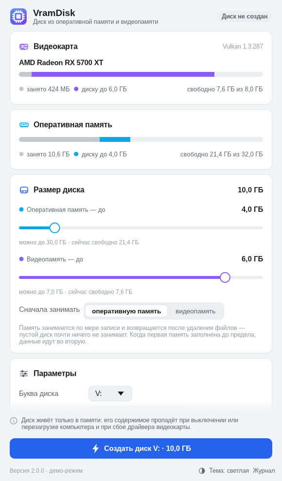
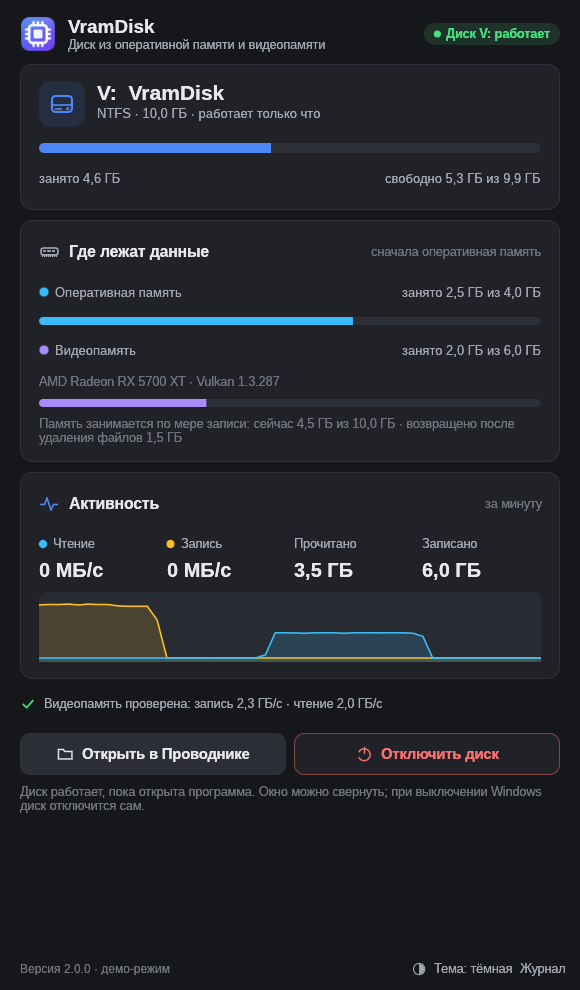

# VramDisk 2.1

Диск для Windows из оперативной памяти **и** видеопамяти. Идея — как у
GpuRamDrive, но программа написана заново на Rust: видеопамять через Vulkan
(запасной путь — Direct3D 11), один «гибридный» диск ОЗУ + видеопамять,
динамическое выделение памяти, аккуратная работа с ImDisk и простой
интерфейс.

| Настройка | Диск подключён |
|---|---|
|  |  |

Снимки сделаны в демо-режиме (имитация видеокарты и ImDisk), цифры на них —
не замер.

## Что нового в 2.1

- **Окно можно закрыть — диск остаётся.** Диск обслуживает фоновая часть
  VramDisk: тот же `vramdisk.exe`, но без окна. Окно только показывает
  состояние и управляет диском — его можно закрывать и открывать снова,
  оно само подключится к работающему диску. Отключается диск кнопкой
  «Отключить диск», после этого фоновая часть завершается сама. Если окно
  закрыто, а с диском беда (сброс драйвера видеокарты, диск перестал
  отвечать), появится сообщение с предложением открыть окно.
- **Меньше оперативной памяти, пока окно закрыто.** Интерфейс и его
  OpenGL-драйвер занимают память, только пока окно открыто. Сколько
  занимает фоновая часть и сколько из этого — данные диска, видно в окне.
  Подробнее — в разделе «Сколько оперативной памяти занимает VramDisk».
- **Автозапуск без окна.** При входе в Windows диск создаётся в фоне;
  сообщение или окно появится, только если что-то пошло не так.

## Что нового в 2.0

- **Исправлено «ImDisk не найден» при установленном ImDisk.** Причина и
  новая проверка — в разделе «Как проверяется ImDisk».
- **Динамический диск.** Память занимается по мере записи файлов и
  возвращается после их удаления. Пустой диск на 20 ГБ почти ничего не
  занимает.
- **Любые видеокарты.** AMD, NVIDIA, Intel — через Vulkan; видеокарты без
  Vulkan (или если Vulkan не запустился) — через Direct3D 11. Если видеокарт
  несколько, нужную можно выбрать в списке.
- **Всё рядом с программой.** Настройки и журнал лежат в папке с
  `vramdisk.exe`, ничего не пишется в AppData и реестр. Настройки версии
  1.0 переносятся автоматически.

## Главное

- Для Windows это обычный диск (например, `V:`) в NTFS или exFAT.
- **Диск живёт только в памяти.** Всё, что на нём лежит, пропадёт при
  выключении или перезагрузке компьютера, при отключении диска, при сбое
  драйвера видеокарты и если завершить процесс VramDisk через Диспетчер
  задач. Не храните там единственную копию важных файлов.
- Подходит для временных файлов, кеша браузера и программ, сборки проектов,
  распаковки архивов.

## Что нужно

- Windows 10 или 11, 64-разрядная.
- [ImDisk Toolkit](https://sourceforge.net/projects/imdisk-toolkit/) (или
  ImDisk Virtual Disk Driver). VramDisk вызывает `imdisk.exe` сам.
- Видеокарта с Vulkan 1.1 или Direct3D 11 и свежим драйвером (RX 5700 XT
  подходит). Можно и без видеопамяти: ползунок видеопамяти на 0 — получится
  обычный динамический RAM-диск.
- Права администратора: ImDisk создаёт диски только от имени администратора,
  программа сама покажет запрос Windows.

## Как пользоваться

1. Распакуйте архив в постоянную папку, куда можно записывать, например
   `C:\VramDisk` (не запускайте прямо из архива — настройки и журнал
   хранятся рядом с программой).
2. Запустите `vramdisk.exe` и подтвердите запрос Windows. Программа не
   подписана, поэтому SmartScreen может предупредить о неизвестном издателе:
   «Подробнее» → «Выполнить в любом случае».
3. Ползунками задайте, **сколько не больше** можно взять из оперативной
   памяти и сколько из видеопамяти. Размер диска — их сумма. «Сначала
   занимать» — какую память расходовать первой. Ниже — буква диска, метка,
   файловая система.
4. Нажмите «Создать диск». Видеопамять проверится, диск отформатируется и
   откроется в Проводнике.
5. Окно можно закрыть: диск продолжит работать в фоне. Чтобы отключить
   диск, снова запустите `vramdisk.exe` и нажмите «Отключить диск».
   **Не завершайте VramDisk через Диспетчер задач** — диск останется без
   обслуживания и обращения к нему будут зависать (при следующем запуске
   программа предложит его убрать, но данные уже не вернуть).

«Создавать при входе в Windows» — диск с этими настройками будет создаваться
сам после входа, без окна (задача `VramDisk` в Планировщике заданий; запрос
прав при каждом входе не появляется).

## Сколько оперативной памяти занимает VramDisk

Пока диск подключён, в Диспетчере задач есть процесс VramDisk — фоновая
часть; пока открыто окно — ещё один. Диск без процесса работать не может:
видеопамять Windows выдаёт процессу и забирает, когда он завершается, а
запросы ImDisk к диску обрабатывает именно этот процесс.

- **Окно** (только пока открыто) — интерфейс и OpenGL-драйвер видеокарты,
  которым он рисуется; у драйвера это заметная часть. Закройте окно — эта
  память освободится.
- **Фоновая часть** — драйвер видеокарты (Vulkan или Direct3D 11),
  промежуточные буферы по 8 МБ для обмена с видеопамятью и с ImDisk,
  таблица блоков диска и **данные диска, которые лежат в оперативной
  памяти**. Сколько из всего этого — данные диска, окно пишет под «Где лежат
  данные».

Как уменьшить:

- «Сначала занимать: видеопамять». Сразу после форматирования и по мере
  работы на диске появляются служебные данные файловой системы — у NTFS
  это прежде всего журнал (на больших дисках — до 64 МБ). Если сначала
  занимается оперативная память, они лежат в ней; если видеопамять — в
  видеопамяти, а оперативная память расходуется, только когда видеопамять
  дошла до своего предела.
- Файловая система exFAT вместо NTFS: у неё нет журнала, служебных данных
  намного меньше. Минусы exFAT: нет прав доступа, сжатия и журнала, а
  некоторые программы требуют NTFS.
- Ползунок оперативной памяти на 0 — диск целиком в видеопамяти (в
  оперативную память данные попадут, только если видеопамять откажет).

## Безопасно ли использовать видеопамять

Для видеокарты — да. VramDisk просит у драйвера память обычным способом,
так же, как игры под текстуры, а копирует данные стандартными командами
передачи (на AMD — DMA-движком). Видеопамять (GDDR) — это DRAM: в отличие
от SSD, от записи она не изнашивается. Разгона, напряжений и вентиляторов
программа не касается, нагрузка на видеокарту при работе диска небольшая.

Риски — для данных и других программ:

- данные пропадают при выключении, перезагрузке, сбое (сбросе) драйвера
  видеокарты и аварийном завершении VramDisk — храните на диске только то,
  что не жалко потерять;
- видеопамять, занятая диском, недоступна играм. Если игре не хватит,
  Windows может вытеснить часть диска в оперативную память — данные
  сохранятся, но и игра, и диск станут медленнее. Перед тяжёлой игрой
  удалите с диска лишнее или отключите его;
- нельзя завершать процесс VramDisk через Диспетчер задач — отключайте
  диск кнопкой в окне.

## Как расходуется память

- Windows сразу видит диск полного размера, но память под него не
  резервируется. Диск поделён на блоки по 64 КБ: блок занимает память только
  после первой записи в него, пустые блоки читаются нулями без обращения к
  памяти.
- Сначала заполняется память, выбранная в «Сначала занимать»; когда она
  дошла до своего предела, данные идут во вторую. Видеопамять берётся у
  драйвера кусками по 64 МБ.
- После удаления файлов память возвращается:
  - по команде TRIM от Windows — если ImDisk её передаёт;
  - проходом очистки: раз в ~10 секунд (если на диск что-то писали)
    программа читает карту свободного места тома и освобождает блоки, целиком
    лежащие в свободных кластерах. Блоки, в которые за это время успели
    что-то записать, не трогаются;
  - если в блок записали одни нули.
- Когда диск простаивает пару секунд, данные в видеопамяти уплотняются, а
  опустевшие куски по 64 МБ отдаются драйверу (через ~5 секунд — на случай,
  если файлы тут же запишут снова).
- Если память отказала — видеопамять заняла игра (программа оставляет
  свободным запас, по умолчанию 1 ГБ) или системе не хватает ОЗУ, — данные
  временно ложатся в другую память сверх её предела, окно об этом
  предупреждает. Когда место появится, они переедут обратно. Если отказали
  обе, запись завершится ошибкой и окно покажет, сколько раз так было.
- В окне видно, где сейчас лежат данные, сколько памяти занято и сколько
  возвращено после удаления файлов.

## Видеокарты

- Основной путь — Vulkan 1.1+. Видеопамять не отображается в память
  программы: данные идут через промежуточный буфер и копируются командами
  передачи (на видеокартах AMD — отдельным DMA-движком).
- Запасной путь — Direct3D 11 (feature level 10.0 и выше): для видеокарт без
  Vulkan и на случай, если Vulkan на этой видеокарте не запустился — тогда
  программа переключится сама и напишет об этом.
- Перед подключением видеопамять проверяется: один кусок 64 МБ пишется,
  читается и сравнивается, заодно замеряется скорость.
- Встроенная или программная видеокарта берёт «видеопамять» из той же
  оперативной памяти — выигрыша не будет, программа об этом предупредит.

## Как проверяется ImDisk

В 1.0 программа считала ImDisk рабочим, только если `imdisk -l` завершалась
с кодом 0. Но по исходникам ImDisk эта команда завершается с кодом **1** и
при успехе (в том числе «No virtual disks.»), и когда драйвер не загружен,
поэтому 1.0 писала «ImDisk не найден» почти у всех.

В 2.0 проверка такая: найден `imdisk.exe` (System32, папка ImDisk или PATH),
и у диспетчера служб Windows есть служба драйвера «ImDisk». Если служба
остановлена, программа запускает её сама. Если что-то не так, окно говорит,
что именно: нет службы (переустановить ImDisk Toolkit), служба отключена
(`sc config ImDisk start= demand`), нет файла `imdisk.sys`, Windows не
приняла подпись драйвера или заблокировала его («Целостность памяти» в
«Изоляции ядра»). После исправления — кнопка «Проверить снова».

## Файлы программы

- Всё своё VramDisk хранит в папке с `vramdisk.exe`: настройки
  `vramdisk.json`, журнал `vramdisk.log` (и предыдущий — `vramdisk.old.log`).
  Если записать туда нельзя, окно предупредит.
- Пока диск подключён, рядом лежит `vramdisk.disk.json` — буква диска,
  номер устройства ImDisk и процесса фоновой части. По нему окно находит
  работающий диск, а после сбоя — оставшийся. При отключении диска файл
  удаляется.
- Вне этой папки — только задача `VramDisk` в Планировщике заданий, и только
  если включён автозапуск. Выключите галочку — задача удалится. Если папку
  с программой перенесли, задача перенастроится при следующем запуске.
- При первом запуске 2.0 настройки 1.0 (`%APPDATA%\VramDisk\settings.json`)
  переносятся к программе, а старые файлы и папки 1.0 удаляются.
- В `vramdisk.json` можно изменить запасы памяти: `ram_reserve_mb` (по
  умолчанию 2048 — сколько ОЗУ не предлагать под диск) и `vram_reserve_mb`
  (по умолчанию 1024 — сколько видеопамяти оставлять свободной).

## Ограничения

- Свободное место в Проводнике — это место на диске, а не свободная память
  прямо сейчас. Если память в это время заняли другие программы, запись
  уйдёт в другую память, а если её нет нигде — завершится ошибкой.
- Видеопамять, занятая диском, недоступна играм. Программа не занимает
  новую видеопамять, если свободной останется меньше запаса, но то, что уже
  занято, сама не отдаёт — удалите файлы с диска или отключите его. Если
  игре не хватит видеопамяти, Windows может вытеснить часть диска в
  оперативную память — данные сохранятся, но всё станет медленнее.
- Скорость ниже, чем у обычного RAM-диска ImDisk: каждый запрос проходит
  через программу, часть в видеопамяти упирается ещё и в шину PCIe.
  Ориентир — порядка 1–3 ГБ/с на крупных файлах (оценка, на настоящей
  видеокарте не замерялось).
- Сброс драйвера видеокарты (например, после вылета игры или неудачного
  разгона) стирает видеопамять. Программа сообщит об этом — скопируйте то,
  что ещё читается, и отключите диск.
- Оперативная часть диска — обычная память фоновой части: при острой
  нехватке памяти Windows может вытеснить часть её в файл подкачки.
- Если ImDisk не передаёт TRIM, память удалённых файлов возвращается с
  задержкой до ~10 секунд (проходом очистки).

## Если что-то пошло не так

- Кнопка «Журнал» внизу окна показывает, что происходило; файл —
  `vramdisk.log` рядом с программой (строки фоновой части помечены
  `[фон]`).
- Фоновая часть закрылась аварийно (или её завершили через Диспетчер
  задач) — открытое окно сразу об этом скажет; если окно было закрыто,
  запустите VramDisk, и он предложит убрать оставшийся диск. Вручную
  (командная строка администратора):
  `imdisk -D -m V:`; если зависает — `imdisk -R -u НОМЕР` (номер покажет
  `imdisk -l`), а букву диска после этого освободит перезагрузка.

## Сборка из исходников

Нужен Rust (stable). На Windows:

```
cargo build --release
```

Из Linux — кросс-сборкой: `rustup target add x86_64-pc-windows-gnu`,
пакет mingw-w64, затем `cargo build --release --target x86_64-pc-windows-gnu`.

Тесты: `cargo test`. Ядро (диск, хранилища, карта свободного места,
протокол ImDisk) не зависит от Windows; видеопамять на Linux проверяется
через программный Vulkan (lavapipe:
`VK_ICD_FILENAMES=/usr/share/vulkan/icd.d/lvp_icd.x86_64.json cargo test`).
Модель диска сверяет каждое чтение с эталоном при случайных записях,
удалениях, отказах памяти и уплотнении; долгий вариант —
`cargo test --release -- --ignored`. На Linux без аргументов программа
запускается в демо-режиме.

## Что проверено

Без настоящей видеокарты AMD и без драйвера ImDisk:

- тесты на Linux (lavapipe) и тесты Windows-сборки в Wine — в том числе
  Vulkan и Direct3D 11 (через Wine) с той же моделью диска;
- сценарии в окне под Wine с имитацией `imdisk.exe` и службы «ImDisk»:
  служба остановлена (программа запустила её), отключена, отсутствует,
  «Проверить снова»; создание диска, сбой ImDisk при создании, «диск занят»,
  принудительное отключение, обычное отключение;
- проход очистки по карте свободного места в Wine проверить нельзя (там нет
  настоящего тома) — проверена только его логика в тестах.

В 2.1 дополнительно под Wine: окно закрыто — диск и фоновая часть
работают; окно открыто снова — подключилось к диску; отключение из окна
(обычное, «диск занят», принудительное) — фоновая часть завершилась и
удалила `vramdisk.disk.json`; сбой ImDisk при создании; фоновая часть
завершена принудительно — окно сообщило и предложило убрать диск;
автозапуск без окна; завершение сеанса Windows — фоновая часть получила
сигнал и начала снимать диск (само снятие в Wine не проходит — там нет
драйвера ImDisk).

На реальной RX 5700 XT с ImDisk версия 2.1 ещё не запускалась — первый раз
попробуйте на небольшом диске и без важных данных. Сколько памяти займёт
фоновая часть с драйвером AMD, заранее неизвестно — окно покажет. Если
что-то не так, пришлите `vramdisk.log`.
